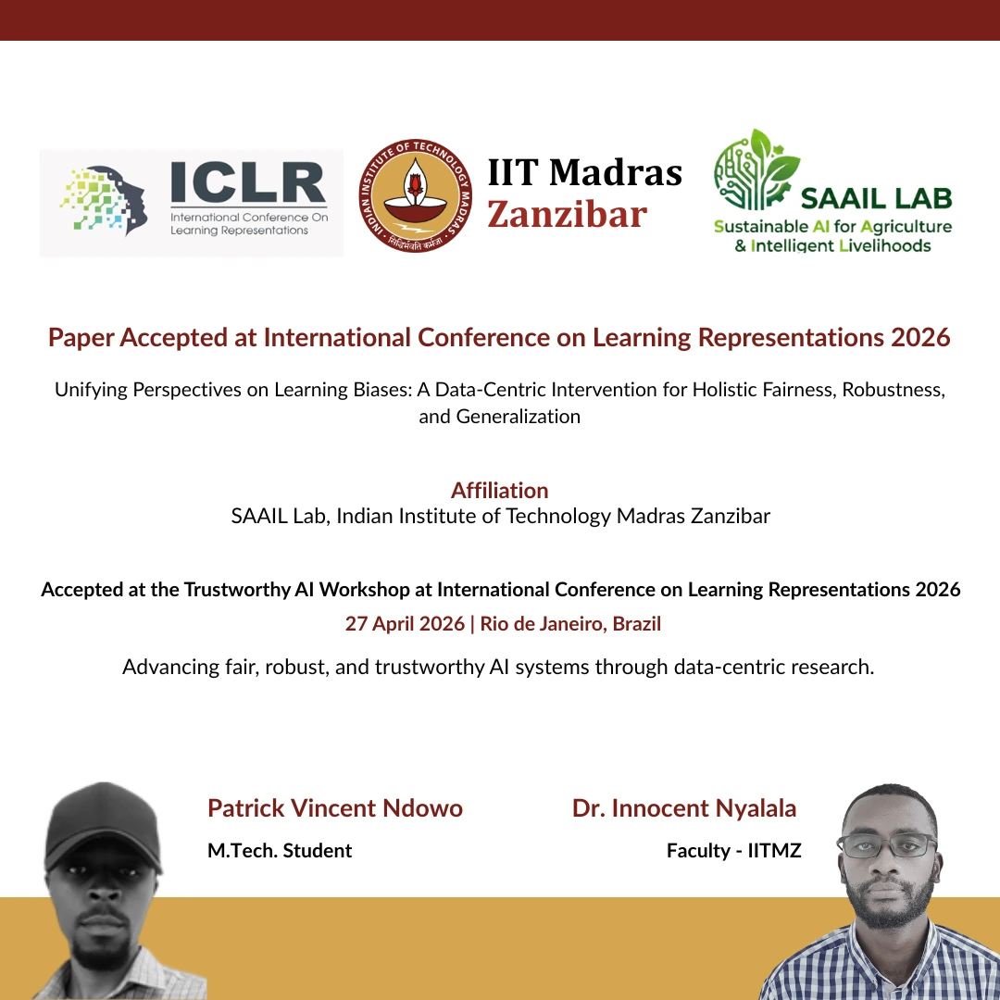

# Unifying Perspectives on Learning Biases: A Data-Centric Intervention for Holistic Fairness, Robustness, and Generalization

**Accepted at the ICLR 2026 Workshop on Principled Design for Trustworthy AI: Interpretability, Robustness, and Safety across Modalities (Rio de Janeiro, Brazil)**

[](https://saaillab.github.io/trustworthy-ai-iclr2026/)
[](https://saaillab.github.io/papers/trustworthy-ai-iclr2026/)
[](https://openreview.net/forum?id=RCEEHTbSDk)
[](LICENSE)

**Authors:** Patrick Vincent Ndowo, Innocent Nyalala  
**Affiliation:** SAAIL Lab, School of Engineering and Science, Indian Institute of Technology Madras Zanzibar, Tanzania  



---

## Abstract

Subgroup fairness disparities, spurious-shortcut sensitivity, and out-of-distribution generalization failures are routinely investigated in separate machine learning subfields despite sharing a common causal source in non-causal spurious correlations baked into training data. We introduce **Dynamic Data Re-weighting (DDR)**, a unified data-centric intervention using adversarial introspection to automatically detect and up-weight high-difficulty, shortcut-dependent examples without requiring expensive explicit spurious-group annotations during training. Evaluated across background biases, attribute shifts, and severe class imbalances, DDR consistently improves Worst-Group Accuracy alongside out-of-distribution generalization.

---

## Conceptual Synthesis: Three Coupled Axes of Learning Bias

| Failure Mode (Usually Siloed) | Shared Data-Centric Root | Dynamic Data Re-weighting (DDR) Effect |
|---|---|---|
| **Algorithmic Unfairness** | Minority subgroup under-representation & spurious group correlation | Up-weights vulnerable minority examples to elevate Worst-Group Accuracy |
| **Shortcut Fragility** | Non-causal texture/background cues dominating empirical risk minimization | Introspection penalizes easy shortcut-exploiting predictions cleanly |
| **OOD Distribution Shift** | Covariate mismatch between controlled train splits and deployment domains | Improves generalization robustness without explicit group attribute labels |

---

## Methodological Workflow of Dynamic Data Re-weighting (DDR)

1. **Adversarial Introspection Pass:** Probes model prediction trajectories across training epochs to detect instances fitted early through unstable or spurious background/attribute shortcuts.
2. **Label-Free Sample Re-weighting:** Dynamically adjusts per-instance optimization weights during training without requiring costly manual spurious-group metadata (`Waterbirds` / `CelebA`-style subgroup labels).
3. **Joint Evaluation Across Regimes:** Validates concurrent improvements across Worst-Group Accuracy, background-shifted splits, and severe long-tail class imbalances.

---

## Algorithmic Intuition & Practical Implementation Scope

Standard Group-DRO algorithms mitigate majority-shortcut memorization only when every training sample carries an explicit nuisance-group label $g \in \mathcal{G}$, an assumption routinely violated in resource-constrained field deployments such as smallholder agricultural imaging or regional clinical records. **DDR** replaces explicit group annotations with training-dynamics difficulty weighting: samples whose empirical risk drops immediately via low-order spurious features receive tempered optimization influence relative to minority, shortcut-conflicting examples.

- **Zero Architecture Lock-In:** Drops cleanly into standard supervised cross-entropy optimization loops over CNN and Vision Transformer backbones.
- **Low Compute Overhead:** Avoids multi-stage generative augmentation or secondary teacher ensembles, making bias mitigation viable under modest academic GPU budgets.

---

## Evaluation Checklist Across Three Bias Regimes

| Evaluation Dimension | Benchmark Challenge | Reported Metric & Verification Goal |
|---|---|---|
| **Subgroup Fairness** | Minority group imbalance without explicit training labels | **Worst-Group Accuracy (WGA)** improvement over ERM baselines |
| **Spurious Shortcut Robustness** | Background / domain attributes correlated with labels | Reduced generalization gap between aligned vs. conflicting groups |
| **Out-of-Distribution Shift** | Covariate shifts from lab/curated sets to natural acquisitions | Elevated balanced accuracy & calibration stability out-of-domain |
| **Post-Audit Accountability** | Connecting fairness, shortcuts, and OOD shift in one pass | Reproducible seeds & inspection-free dynamic sample weights |

---

## Reproducibility & OpenReview Forum Details

Accepted and presented at the **ICLR 2026 Workshop on Principled Design for Trustworthy AI: Interpretability, Robustness, and Safety across Modalities** (Rio de Janeiro, Brazil). Full discussion threads and workshop camera-ready metadata are archived on the [OpenReview Forum (`RCEEHTbSDk`)](https://openreview.net/forum?id=RCEEHTbSDk) alongside the companion [SAAIL Lab project summary](https://saaillab.github.io/papers/trustworthy-ai-iclr2026/).

- **Workshop Track:** Principled Design for Trustworthy AI (Interpretability, Robustness, and Safety across Modalities)
- **Target Applications:** Subgroup-blind debiasing in low-resource vision and clinical ML where explicit nuisance labels cannot be annotated cleanly at scale
- **Companion Audit Tooling:** Integrates naturally with SAAIL Lab deployment-gap (`DGS-Bench`) and dataset-representation (`DSA 2026`) verification workflows
- **Author Profiles:** [Innocent Nyalala](https://inyalala.github.io/) · [Patrick Vincent Ndowo](https://www.linkedin.com/in/patrick-ndowo/) · [SAAIL Lab (IIT Madras Zanzibar)](https://saaillab.github.io/)
- **Open-Source License:** Released under the [MIT License](LICENSE) by SAAIL Lab, School of Engineering and Science, Indian Institute of Technology Madras Zanzibar

---

## Links Across SAAIL Lab Responsible AI Studies

- **DGS-Bench (`DLI 2026 Best Poster Award`):** Quantifies deployment gap mirages on 19,397 smallholder field captures -> [Paper Page](https://saaillab.github.io/papers/dgs-bench/)
- **Auditing Representation (`DSA 2026 Kampala`):** Proposes the 6-item AgriAI Bias Card comparing PlantVillage vs. iCassava & iBean -> [Paper Page](https://saaillab.github.io/papers/auditing-crop-datasets-dsa2026/)
- **CropGuardNet (`Manuscript Under Review`):** Eliminates 80,238 leaked PlantVillage copies via UUID & 64-bit pHash auditing -> [GitHub Repo](https://github.com/saaillab/CropGuardNet)
- **ETRI Journal (2026):** Compositional Explanation Evidence Ratio (`100% EER`) under background shift (`DOI: 10.4218/etrij.2026-0225`) -> [Paper Page](https://saaillab.github.io/papers/clove-xai-etri2026/)

---

## Repository Contents

```text
trustworthy-ai-iclr2026/
├── README.md
├── LICENSE
├── CITATION.cff
└── docs/
    ├── index.html                           # Standalone ICLR 2026 project page
    └── assets/
        ├── iclr-2026-trustworthy-ai.webp    # ICLR 2026 workshop spotlight graphic
        └── saail-crest.png
```

---

## Citation

```bibtex
@inproceedings{ndowo2026unifying,
  title={Unifying Perspectives on Learning Biases: A Data-Centric Intervention for Holistic Fairness, Robustness, and Generalization},
  author={Ndowo, Patrick Vincent and Nyalala, Innocent},
  booktitle={ICLR 2026 Workshop on Principled Design for Trustworthy AI: Interpretability, Robustness, and Safety across Modalities},
  address={Rio de Janeiro, Brazil},
  year={2026},
  url={https://openreview.net/forum?id=RCEEHTbSDk}
}
```

Maintained by **[SAAIL Lab](https://saaillab.github.io/)**, School of Engineering and Science, Indian Institute of Technology Madras Zanzibar, Tanzania.
